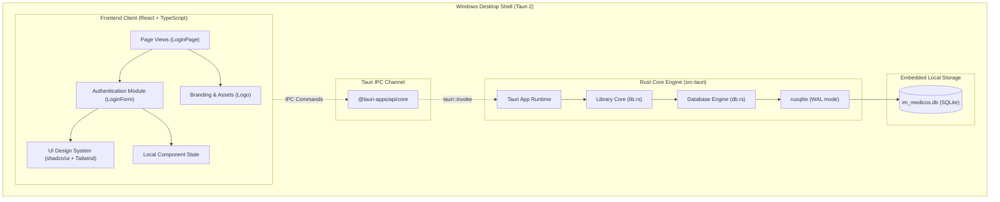
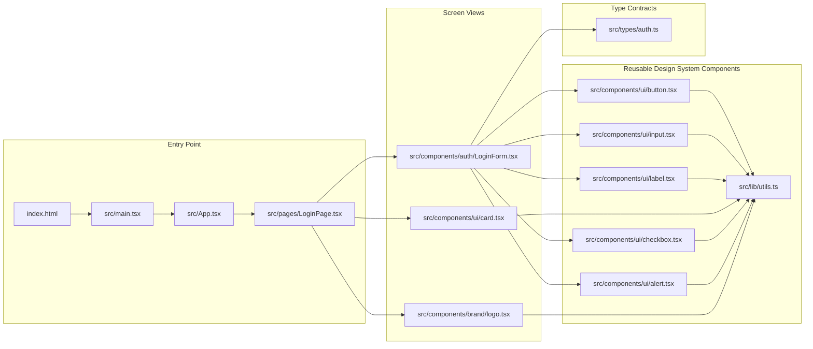

# IM MEDICOS — Architecture & Knowledge Graph

## 1. System Architecture Overview

IM MEDICOS is engineered with a decoupled desktop architecture:

---

## 2. Component Dependency Graph

---

## 3. Knowledge Graph (Graphify Engine)

Official **Graphify** has been installed and generated interactive AST mappings of the codebase:

- **Interactive Knowledge Graph:** `graphify-out/graph.html` (visualizes code modules, dependencies, and cross-file relationships).
- **Graph Structural Manifest:** `graphify-out/graph.json` (node-and-edge graph model for semantic traversal).
- **Architecture Summary:** `graphify-out/GRAPH_REPORT.md` (clustering and community breakdown).

### Extracted Code Graph Summary
- **Nodes mapped:** 154 AST symbols and code artifacts
- **Edges mapped:** 229 cross-symbol calls, imports, and definitions
- **Communities detected:** 16 functional clusters

---

## 4. Frontend Design System Guidelines

- **Primary Tone:** Deep Medical Navy (`#0d2545` / `#133560`) — conveys trustworthiness, clinical precision, and commercial Windows software quality.
- **Accent Tone:** Subtle Medical Emerald (`#059669` / `#10b981`) — represents health, active status, and validation confirmation.
- **Surfaces:** Clean White (`#ffffff`) and cool slate tint (`#f8fafc` / `#f1f5f9`).
- **Borders & Dividers:** High-precision subtle borders (`#e2e8f0`).
- **Typography:** Segoe UI / Inter modern sans-serif typography with strict visual hierarchy.
