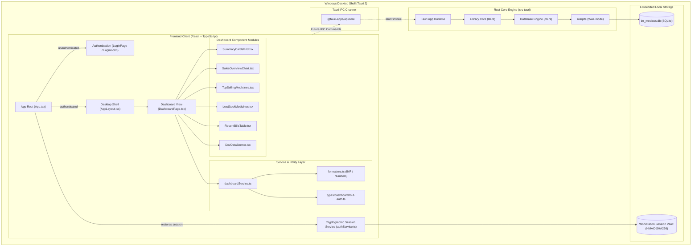
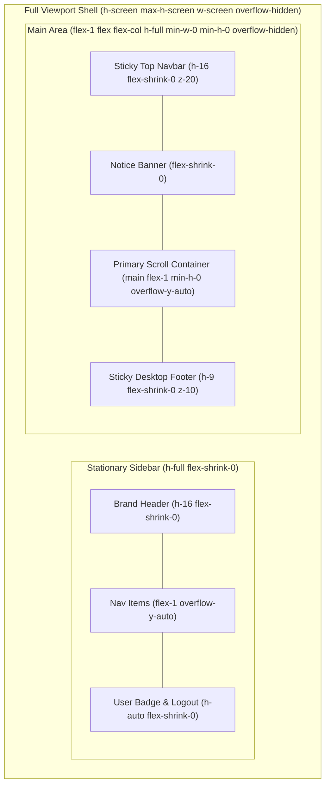

# IM MEDICOS — Architecture & Knowledge Graph

## 1. System Architecture Overview

IM MEDICOS is engineered with a decoupled desktop architecture:

---

## 2. Desktop Viewport & Scrolling Architecture

---

## 3. Knowledge Graph (Graphify Engine)

Official **Graphify** mapped AST relationships across the entire workspace:

- **Interactive Visual Graph:** `graphify-out/graph.html` (interactive nodes, links, and community clusters).
- **Graph Structural Manifest:** `graphify-out/graph.json` (node-and-edge model).
- **Architecture Summary:** `graphify-out/GRAPH_REPORT.md` (clustering breakdown).

### Extracted Code Graph Summary
- **Nodes mapped:** 252 AST symbols and code artifacts
- **Edges mapped:** 461 cross-symbol calls, imports, and definitions
- **Communities detected:** 18 functional clusters

---

## 4. Cryptographic Session Security Specification

- **Zero Plain-Text Credentials:** Passwords are never serialized into persistent client storage.
- **HMAC-SHA256 Token Signing:** Every session ticket is signed via the native Web Crypto API (`crypto.subtle`) using a local workstation key.
- **Tamper Protection:** Any out-of-band manipulation of `username`, `role`, or `expiresAt` in client storage invalidates the cryptographic signature, triggering an immediate session purge.
- **No Login Flash:** Application initialization displays an integrated security loading splash while asynchronous session restoration occurs.
