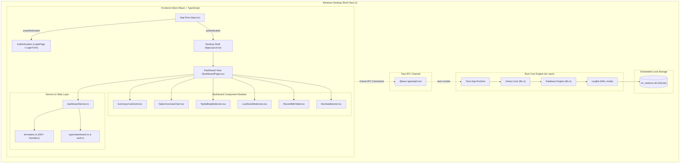
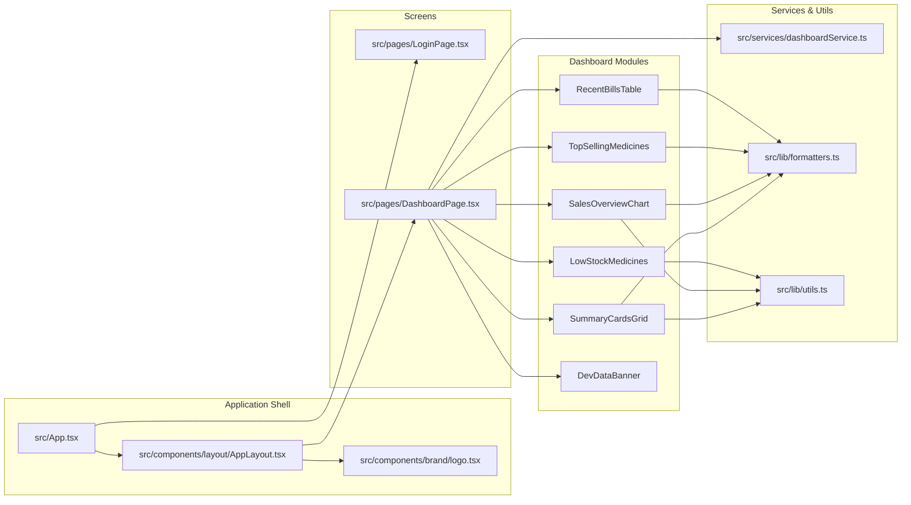

# IM MEDICOS — Architecture & Knowledge Graph

## 1. System Architecture Overview

IM MEDICOS is engineered with a decoupled desktop architecture:

---

## 2. Component Dependency Graph

---

## 3. Knowledge Graph (Graphify Engine)

Official **Graphify** mapped AST relationships across the entire workspace:

- **Interactive Visual Graph:** `graphify-out/graph.html` (interactive nodes, links, and community clusters).
- **Graph Structural Manifest:** `graphify-out/graph.json` (node-and-edge model).
- **Architecture Summary:** `graphify-out/GRAPH_REPORT.md` (clustering breakdown).

### Extracted Code Graph Summary
- **Nodes mapped:** 237 AST symbols and code artifacts
- **Edges mapped:** 441 cross-symbol calls, imports, and definitions
- **Communities detected:** 19 functional clusters

---

## 4. Design System Compliance

- **Primary Tone:** Deep Medical Navy (`#091a32` to `#133560`) — professional clinical anchor.
- **Accent Tone:** Subtle Medical Emerald (`#059669` / `#10b981`) — represents positive trends, active status, and validation.
- **Alert Tones:** Amber (`#b45309`) and Red (`#dc2626`) — reserved exclusively for inventory depletion warnings.
- **Surfaces:** Clean White (`#ffffff`) and cool slate tint (`#f8fafc` / `#f1f5f9`).
- **Currency Standard:** Indian Rupee formatting (`₹`) with Lakhs/Crores grouping.
