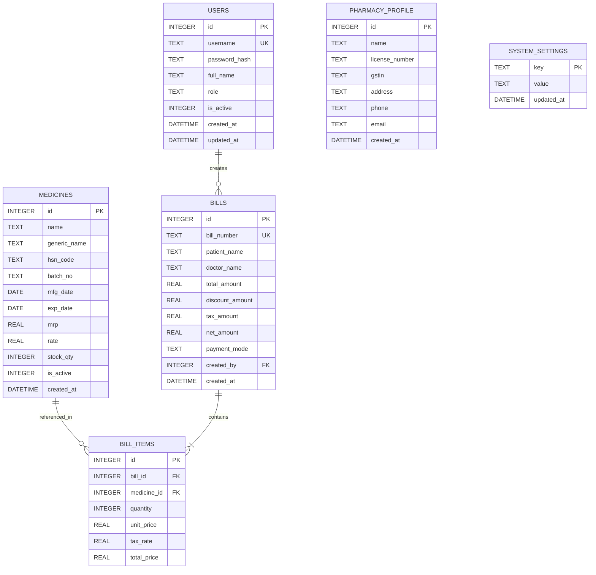

# IM MEDICOS — Database Schema (SQLite Foundation)

## 1. Overview
IM MEDICOS uses an embedded SQLite database configured for zero cloud dependency, zero network leakage, and maximum local transaction performance.

- **Storage Engine:** SQLite 3 with Write-Ahead Logging (`PRAGMA journal_mode = WAL`)
- **Referential Integrity:** Enforced via `PRAGMA foreign_keys = ON`
- **Location:** Windows `%APPDATA%/com.immedicos.billing/im_medicos.db`

---

## 2. Entity-Relationship Diagram

---

## 3. Schema Definitions

### `store_details` (Singleton Record: ID = 1)
Central store configuration, compliance license numbers, invoice sequence counters, and branding assets.
| Column | Type | Constraints | Description |
| :--- | :--- | :--- | :--- |
| `id` | `INTEGER` | `PRIMARY KEY CHECK (id = 1)` | Singleton row enforcement |
| `store_name` | `TEXT` | `NOT NULL` | Official Pharmacy / Store Name (Mandatory) |
| `address` | `TEXT` | `NULLABLE` | Full multiline physical store address |
| `phone` | `TEXT` | `NULLABLE` | Contact telephone / mobile |
| `email` | `TEXT` | `NULLABLE` | Store email address |
| `gstin` | `TEXT` | `NULLABLE` | 15-character Indian GSTIN identification |
| `drug_license_1` | `TEXT` | `NULLABLE` | Form 20B drug license certificate |
| `drug_license_2` | `TEXT` | `NULLABLE` | Form 21B drug license certificate |
| `owner_name` | `TEXT` | `NULLABLE` | Proprietor / Owner legal name |
| `pharmacist_name` | `TEXT` | `NULLABLE` | Registered in-charge pharmacist name |
| `pharmacist_reg_no`| `TEXT` | `NULLABLE` | Pharmacy council registration number |
| `bill_prefix` | `TEXT` | `NOT NULL DEFAULT 'IM'` | Invoice numbering prefix string |
| `starting_bill_number`| `INTEGER` | `NOT NULL DEFAULT 1` | Invoice starting sequence number |
| `show_gstin_on_invoice`| `INTEGER` | `NOT NULL DEFAULT 1` | Boolean toggle (1=true, 0=false) |
| `show_amount_in_words`| `INTEGER` | `NOT NULL DEFAULT 1` | Boolean toggle (1=true, 0=false) |
| `footer_terms` | `TEXT` | `NULLABLE` | Default invoice footer terms & return policy |
| `bank_name` | `TEXT` | `NULLABLE` | Settlement bank name |
| `account_holder_name`| `TEXT` | `NULLABLE` | Bank account holder name |
| `account_number` | `TEXT` | `NULLABLE` | Bank account number |
| `ifsc_code` | `TEXT` | `NULLABLE` | 11-character Indian Financial System Code |
| `upi_id` | `TEXT` | `NULLABLE` | Virtual Payment Address (e.g. store@upi) |
| `low_stock_threshold`| `INTEGER` | `NOT NULL DEFAULT 10` | Global inventory low-stock alert cutoff |
| `logo_path` | `TEXT` | `NULLABLE` | Relative path to logo in local app directory |
| `updated_at` | `DATETIME` | `DEFAULT CURRENT_TIMESTAMP` | Last updated timestamp |

### `users`
Stores credentials and authorization levels for clinic staff.
| Column | Type | Constraints | Description |
| :--- | :--- | :--- | :--- |
| `id` | `INTEGER` | `PRIMARY KEY AUTOINCREMENT` | Unique user ID |
| `username` | `TEXT` | `NOT NULL UNIQUE` | System login name |
| `password_hash` | `TEXT` | `NOT NULL` | Argon2/PBKDF2 hash (dev placeholder: `admin123`) |
| `full_name` | `TEXT` | `NOT NULL` | Display name of staff member |
| `role` | `TEXT` | `CHECK(role IN ('admin', 'pharmacist', 'biller'))` | Access privilege level |
| `is_active` | `INTEGER` | `DEFAULT 1` | Status (1=active, 0=deactivated) |
| `created_at` | `DATETIME` | `DEFAULT CURRENT_TIMESTAMP` | Audit creation timestamp |
| `updated_at` | `DATETIME` | `DEFAULT CURRENT_TIMESTAMP` | Last updated timestamp |

### `pharmacy_profile`
Clinic and billing header details for print receipts.
| Column | Type | Constraints | Description |
| :--- | :--- | :--- | :--- |
| `id` | `INTEGER` | `PRIMARY KEY AUTOINCREMENT` | Profile identifier |
| `name` | `TEXT` | `NOT NULL` | Pharmacy / Clinic name |
| `license_number` | `TEXT` | `NULLABLE` | Drug license number |
| `gstin` | `TEXT` | `NULLABLE` | GST identification number |
| `address` | `TEXT` | `NULLABLE` | Physical address |
| `phone` | `TEXT` | `NULLABLE` | Contact telephone |
| `email` | `TEXT` | `NULLABLE` | Contact email |

### `medicines`
Master pharmacy medicine registry. Total stock is calculated dynamically by summing active batch quantities.
| Column | Type | Constraints | Description |
| :--- | :--- | :--- | :--- |
| `id` | `INTEGER` | `PRIMARY KEY AUTOINCREMENT` | Unique medicine ID |
| `name` | `TEXT` | `NOT NULL` | Brand / trade name |
| `generic_name` | `TEXT` | `NULLABLE` | Active chemical composition |
| `manufacturer` | `TEXT` | `NULLABLE` | Pharmaceutical manufacturer |
| `category` | `TEXT` | `NULLABLE` | Therapeutic classification |
| `description` | `TEXT` | `NULLABLE` | Clinical notes & dosage instructions |
| `barcode` | `TEXT` | `NULLABLE` | Standard EAN/UPC barcode string |
| `hsn_code` | `TEXT` | `NULLABLE` | Harmonized System Code for GST compliance |
| `unit` | `TEXT` | `NOT NULL DEFAULT 'Tablet'` | Dispensing unit (Tablet, Strip, Bottle, etc.) |
| `low_stock_threshold`| `INTEGER` | `NOT NULL DEFAULT 10` | Low stock alert threshold |
| `is_active` | `INTEGER` | `NOT NULL DEFAULT 1` | Soft-delete / active status flag |
| `created_at` | `DATETIME` | `DEFAULT CURRENT_TIMESTAMP` | Registration timestamp |
| `updated_at` | `DATETIME` | `DEFAULT CURRENT_TIMESTAMP` | Last updated timestamp |

### `medicine_batches`
Batch-specific inventory, individual expiry dates, and pricing records.
| Column | Type | Constraints | Description |
| :--- | :--- | :--- | :--- |
| `id` | `INTEGER` | `PRIMARY KEY AUTOINCREMENT` | Unique batch record ID |
| `medicine_id` | `INTEGER` | `NOT NULL REFERENCES medicines(id)` | Parent medicine reference |
| `batch_number` | `TEXT` | `NOT NULL` | Physical batch / lot identifier |
| `mfg_date` | `DATE` | `NULLABLE` | Manufacturing date |
| `exp_date` | `DATE` | `NOT NULL` | Expiry date (determines 10-day alert & saleability) |
| `cost_price` | `REAL` | `NOT NULL DEFAULT 0.0` | Purchase cost per unit (internal only) |
| `mrp` | `REAL` | `NOT NULL DEFAULT 0.0` | Maximum Retail Price |
| `selling_price`| `REAL` | `NOT NULL DEFAULT 0.0` | Default customer billing price |
| `stock_qty` | `INTEGER` | `NOT NULL DEFAULT 0` | Available stock units in this batch |
| `is_active` | `INTEGER` | `NOT NULL DEFAULT 1` | Active batch status flag |
| `created_at` | `DATETIME` | `DEFAULT CURRENT_TIMESTAMP` | Record timestamp |
| `updated_at` | `DATETIME` | `DEFAULT CURRENT_TIMESTAMP` | Last updated timestamp |

### `stock_movements`
Complete audit trail for stock additions, adjustments, sales, and reductions.
| Column | Type | Constraints | Description |
| :--- | :--- | :--- | :--- |
| `id` | `INTEGER` | `PRIMARY KEY AUTOINCREMENT` | Unique movement transaction ID |
| `medicine_id` | `INTEGER` | `NOT NULL REFERENCES medicines(id)` | Associated medicine |
| `batch_id` | `INTEGER` | `NULLABLE REFERENCES medicine_batches(id)` | Associated batch |
| `movement_type`| `TEXT` | `NOT NULL` | OPENING_STOCK, PURCHASE, ADJUSTMENT_ADD, ADJUSTMENT_REDUCE, SALE, DAMAGE, RETURN |
| `quantity` | `INTEGER` | `NOT NULL` | Units adjusted |
| `previous_qty` | `INTEGER` | `NOT NULL` | Batch stock prior to movement |
| `new_qty` | `INTEGER` | `NOT NULL` | Batch stock after movement |
| `reason` | `TEXT` | `NULLABLE` | User audit reason or invoice reference |
| `reference_id` | `TEXT` | `NULLABLE` | External invoice / document reference ID |
| `created_at` | `DATETIME` | `DEFAULT CURRENT_TIMESTAMP` | Transaction timestamp |

### `bills` (Foundation)
Invoice headers and patient billing ledger.
| Column | Type | Constraints | Description |
| :--- | :--- | :--- | :--- |
| `id` | `INTEGER` | `PRIMARY KEY AUTOINCREMENT` | Unique billing record ID |
| `bill_number` | `TEXT` | `NOT NULL UNIQUE` | Human-readable receipt invoice number |
| `patient_name` | `TEXT` | `NOT NULL` | Customer / Patient name |
| `doctor_name` | `TEXT` | `NULLABLE` | Referring or prescribing doctor |
| `total_amount` | `REAL` | `NOT NULL` | Subtotal |
| `discount_amount`| `REAL` | `DEFAULT 0` | Discount deducted |
| `tax_amount` | `REAL` | `DEFAULT 0` | Computed GST amount |
| `net_amount` | `REAL` | `NOT NULL` | Final payable balance |
| `payment_mode` | `TEXT` | `DEFAULT 'CASH'` | Payment method (CASH, CARD, UPI) |
| `created_by` | `INTEGER` | `REFERENCES users(id)` | User who recorded the transaction |
| `created_at` | `DATETIME` | `DEFAULT CURRENT_TIMESTAMP` | Billing timestamp |

