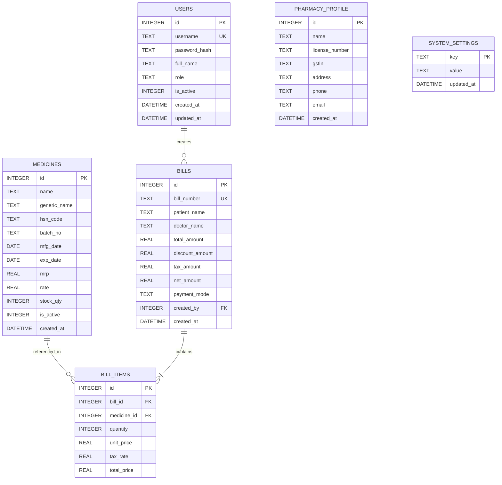

# IM MEDICOS — Database Schema (SQLite Foundation)

## 1. Overview
IM MEDICOS uses an embedded SQLite database configured for zero cloud dependency, zero network leakage, and maximum local transaction performance.

- **Storage Engine:** SQLite 3 with Write-Ahead Logging (`PRAGMA journal_mode = WAL`)
- **Referential Integrity:** Enforced via `PRAGMA foreign_keys = ON`
- **Location:** Windows `%APPDATA%/com.immedicos.billing/im_medicos.db`

---

## 2. Entity-Relationship Diagram

---

## 3. Schema Definitions

### `users`
Stores credentials and authorization levels for clinic staff.
| Column | Type | Constraints | Description |
| :--- | :--- | :--- | :--- |
| `id` | `INTEGER` | `PRIMARY KEY AUTOINCREMENT` | Unique user ID |
| `username` | `TEXT` | `NOT NULL UNIQUE` | System login name |
| `password_hash` | `TEXT` | `NOT NULL` | Argon2/PBKDF2 hash (dev placeholder: `admin123`) |
| `full_name` | `TEXT` | `NOT NULL` | Display name of staff member |
| `role` | `TEXT` | `CHECK(role IN ('admin', 'pharmacist', 'biller'))` | Access privilege level |
| `is_active` | `INTEGER` | `DEFAULT 1` | Status (1=active, 0=deactivated) |
| `created_at` | `DATETIME` | `DEFAULT CURRENT_TIMESTAMP` | Audit creation timestamp |
| `updated_at` | `DATETIME` | `DEFAULT CURRENT_TIMESTAMP` | Last updated timestamp |

### `pharmacy_profile`
Clinic and billing header details for print receipts.
| Column | Type | Constraints | Description |
| :--- | :--- | :--- | :--- |
| `id` | `INTEGER` | `PRIMARY KEY AUTOINCREMENT` | Profile identifier |
| `name` | `TEXT` | `NOT NULL` | Pharmacy / Clinic name |
| `license_number` | `TEXT` | `NULLABLE` | Drug license number |
| `gstin` | `TEXT` | `NULLABLE` | GST identification number |
| `address` | `TEXT` | `NULLABLE` | Physical address |
| `phone` | `TEXT` | `NULLABLE` | Contact telephone |
| `email` | `TEXT` | `NULLABLE` | Contact email |

### `medicines` (Foundation)
Inventory and stock master.
| Column | Type | Constraints | Description |
| :--- | :--- | :--- | :--- |
| `id` | `INTEGER` | `PRIMARY KEY AUTOINCREMENT` | Primary key |
| `name` | `TEXT` | `NOT NULL` | Brand / trade name |
| `generic_name` | `TEXT` | `NULLABLE` | Active chemical composition |
| `hsn_code` | `TEXT` | `NULLABLE` | Harmonized System Code for GST |
| `batch_no` | `TEXT` | `NULLABLE` | Production batch |
| `mfg_date` | `DATE` | `NULLABLE` | Manufacturing date |
| `exp_date` | `DATE` | `NULLABLE` | Expiry date |
| `mrp` | `REAL` | `NOT NULL` | Maximum Retail Price |
| `rate` | `REAL` | `NOT NULL` | Purchase rate / cost |
| `stock_qty` | `INTEGER` | `DEFAULT 0` | Available quantity units |

### `bills` (Foundation)
Invoice headers and patient billing ledger.
| Column | Type | Constraints | Description |
| :--- | :--- | :--- | :--- |
| `id` | `INTEGER` | `PRIMARY KEY AUTOINCREMENT` | Unique billing record ID |
| `bill_number` | `TEXT` | `NOT NULL UNIQUE` | Human-readable receipt invoice number |
| `patient_name` | `TEXT` | `NOT NULL` | Customer / Patient name |
| `doctor_name` | `TEXT` | `NULLABLE` | Referring or prescribing doctor |
| `total_amount` | `REAL` | `NOT NULL` | Subtotal |
| `discount_amount`| `REAL` | `DEFAULT 0` | Discount deducted |
| `tax_amount` | `REAL` | `DEFAULT 0` | Computed GST amount |
| `net_amount` | `REAL` | `NOT NULL` | Final payable balance |
| `payment_mode` | `TEXT` | `DEFAULT 'CASH'` | Payment method (CASH, CARD, UPI) |
| `created_by` | `INTEGER` | `REFERENCES users(id)` | User who recorded the transaction |
| `created_at` | `DATETIME` | `DEFAULT CURRENT_TIMESTAMP` | Billing timestamp |

